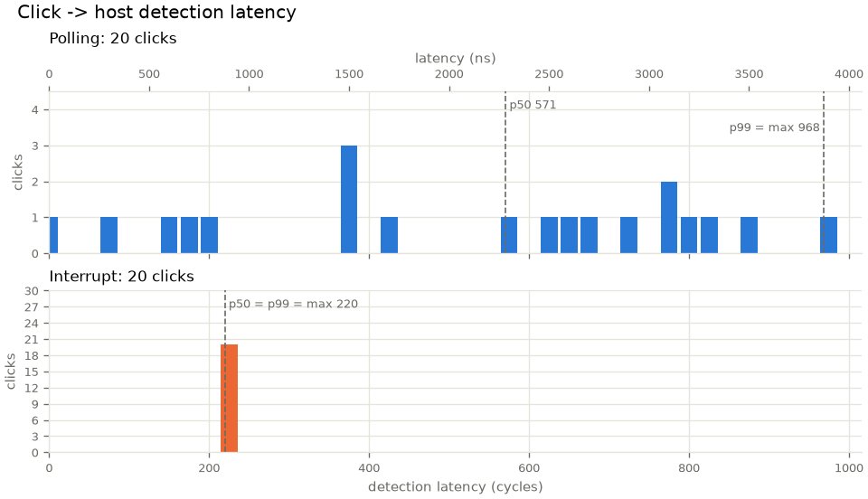
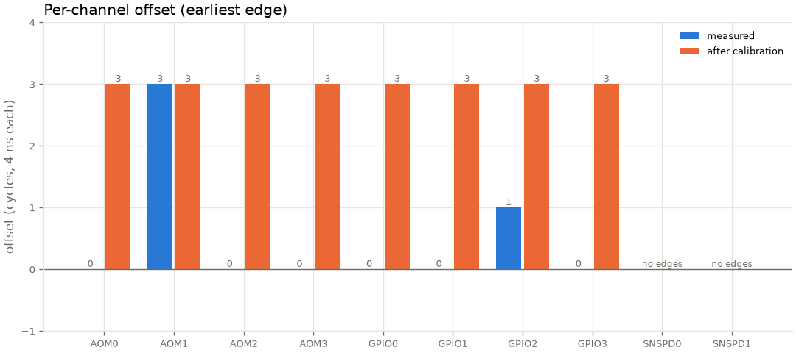
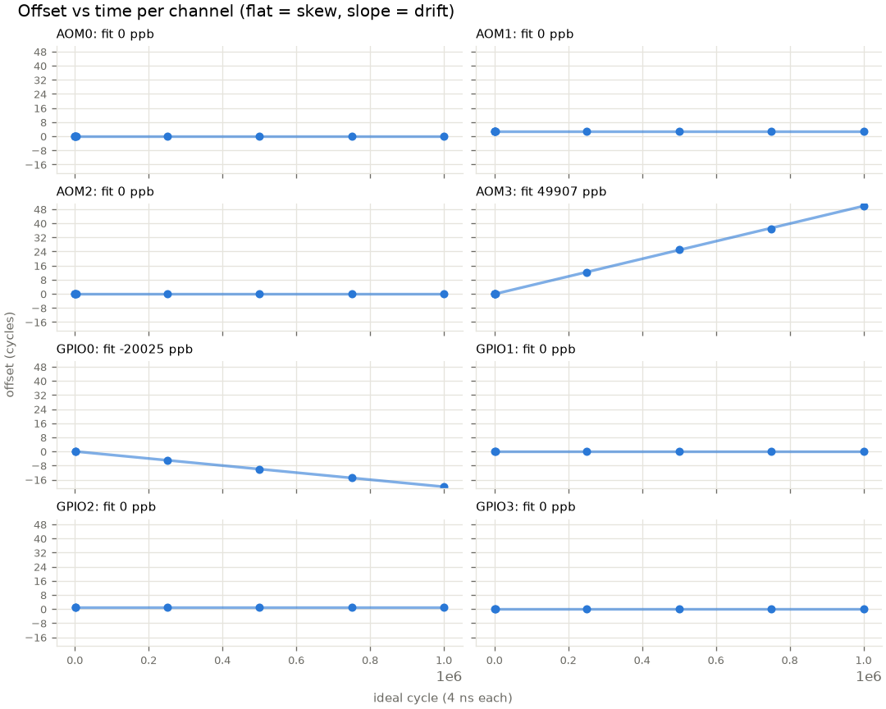
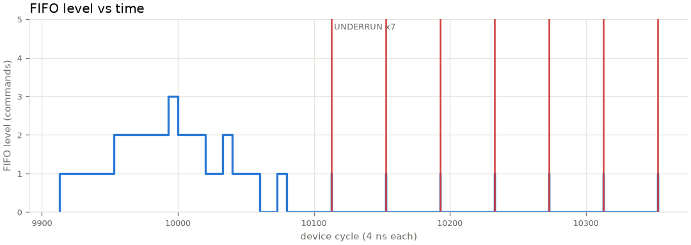

# qtwin


**A deterministic, register-level Python model of an FPGA timing-control box, plus the host driver
that programs it, calibrates it and reacts to detector clicks in real time.**



*Same 20 detector clicks, two drivers. Polling: p50 571 cycles, max 968, 1 699 bus reads.
Interrupt: 220 cycles for every click, 63 bus reads. 1 cycle = 4 ns.*

- **What it is:** a 250 MHz device (register map, command FIFO, sequencer, 4 AOM + 4 GPIO outputs,
  2 SNSPD detector inputs, IRQ line) behind a bus with latency and seeded jitter. The driver
  can reach the device only through `read32`/`write32`.
- **What it shows:** timed command streaming, FIFO underrun/overflow, skew calibration with delay
  lines, drift detection, polling vs. interrupt latency, and a 400-cycle (1.6 µs) closed feedback loop.
- **Status:** milestones M0-M7 done. 652 tests pass, `mypy --strict` and `ruff` are clean, and 8 golden
  traces compare byte for byte. M8 (C++ lock-free ring buffer) is planned and **not started**.
- **What it is not:** RTL or a cycle-exact silicon model. The physics is crude on purpose
  ([limitations](docs/limitations.md)).

---

## Why

Control software for lab hardware (quantum, optics, test and measurement) is mostly about time: getting a
command to an output on the exact clock cycle, finding out when that failed, and fixing timing
errors you cannot see directly. Those problems are hard to show without the hardware. qtwin models
them at the level a driver engineer works at: registers, a FIFO, an interrupt line and a bus that
costs time. Every timing claim can then be tested exactly and repeated.

## Four design decisions

**1. The driver talks to the device only through registers.**
Driver code may import `bus`, `device/registers.py` and the read-only `scope` API, never the rest
of `qtwin.device`. An ast-based test enforces this ([`tests/test_architecture.py`](tests/test_architecture.py)).
It checks imports statically, so it also catches code that no test runs. The register map is
defined once in [`registers.py`](src/qtwin/device/registers.py) and documented in
[`docs/registers.md`](docs/registers.md): W1C status bits, a latched 64-bit cycle counter, a
4-word command frame that commits on the last word.

**2. The model hides faults. The driver has to find them.**
Per-lane skew and drift are passed to `Device(timing=...)` and never appear in a register. The
calibration driver ([`driver/calibration.py`](src/qtwin/driver/calibration.py)) sends test edges,
measures them on the Scope (like a lab scope on the outputs), and writes `SKEW_TRIM` registers.
These are positive-only delay lines, so every lane is aligned to the slowest one:
`SKEW_TRIM_i = max_skew - skew_i`. Drift is estimated from two edges 10^6 cycles apart and
flagged above 2 000 ppb. Drift is detected, not compensated.

**3. Integer cycles and seeds: same seed, same trace.**
All scheduling is in integer 4 ns cycles. Seconds become cycles only at the API edge, with exact
rational arithmetic and half-even rounding ([`timebase.py`](src/qtwin/timebase.py)). Drift is
integer ppb, truncated toward zero. Bus jitter and detector clicks come from seeded generators.
No wall clock anywhere. The result: golden traces compare exactly, and timing tests assert exact
cycles (e.g. a frame landing on its own timestamp is on time, one cycle later is late).

**4. Timing errors never stop the device, but they are always visible.**
A late command still runs and sets a sticky `LATE` flag. Dropping a late "beam off" would leave
the beam on. A command into a full FIFO is dropped, sets `OVERFLOW` and is counted in a
saturating `DROPPED` register. A starved sequencer sets `UNDERRUN`. Each error sets a bit in both
`STATUS` and `IRQ_STATUS`, cleared separately (clear the flag vs. acknowledge the interrupt).
*Driver bugs* are a different case and fail loudly on purpose: writing a read-only register, an
unaligned/unmapped address or a value over 32 bits raises `BusError`/`ValueError`. Real hardware
would ignore these and hide the bug.

## Results

| | |
|---|---|
|  | **Skew calibration (`mixed` scenario).** The driver finds AOM1 +3 and GPIO2 +1 cycles of hidden skew and delays every other lane to match, so all 8 outputs line up at 3 cycles with 0 residual. |
|  | **Drift (`mixed` scenario).** Flat lines are skew, slopes are drift. Calibration reports AOM3 at +50 000 ppb and GPIO0 at -20 000 ppb, the hidden values, and flags both. |
|  | **Underrun (`underrun` scenario).** The host needs 40 cycles per command, commands are 20 apart. The FIFO drains, and the device flags 7 underruns, each on the cycle the late command arrives. |

More M7 numbers ([`docs/m7_report.md`](docs/m7_report.md)): with a 5 000-cycle poll period, the
polling driver underruns a 400-command stream (167 late). The interrupt driver with watermark 16
delivers all 400 on time. The watermark formula is checked at its boundary: 6 runs clean, 5
underruns. The click-to-AOM feedback edge is exactly 400 cycles for all 20 clicks, with write
jitter and across the 32-bit `LAST_TS` wrap.

## How to run

Windows PowerShell, Python 3.11+ (developed on 3.13):

```powershell
py -3.13 -m venv .venv ; .venv\Scripts\Activate.ps1 ; pip install -e ".[dev]"
pytest -q
python -m qtwin.analysis.plots --drivers      # writes out/drivers/latency_histograms.png
```

Other plots: `python -m qtwin.analysis.plots --scenario mixed --calibrate` (scenarios: `ideal`,
`skew_some`, `drift_some`, `mixed`, `one_both`, `bus_jitter`, `underrun`, `overflow`).
Checks: `mypy src`, `ruff check .`.

## Project layout

```
src/qtwin/
  timebase.py        seconds <-> integer cycles (exact, half-even)
  bus.py             read32/write32 with bus_latency_cycles and seeded jitter
  device/            clock, registers (single source of truth), fifo, sequencer, snspd, device
  driver/            base (streaming, frames), calibration, polling, interrupt
  scope.py           passive recorder of every output edge + measurement helpers
  scenarios.py       named fault/bus/driver scenarios
  analysis/          stats (integer percentiles, fit), plots (matplotlib, Agg)
tests/               652 tests (M7), golden traces in tests/golden/
docs/                registers, decisions, limitations, concepts, architecture, m7_report
cpp/ringbuffer/      M8, planned, not started
```

## How it was built with Claude Code

Built milestone by milestone (M0-M7) with Claude Code, under rules written in
[`CLAUDE.md`](CLAUDE.md):

- **Plan first.** Each milestone started in plan mode and was approved before any code. Where the
  code later departed from the plan, the milestone report says so (e.g. the M7 "ack flush").
- **Tests first.** New tests were written and seen failing before the code. The
  [M7 report](docs/m7_report.md) lists failing → passing counts per commit. A test was changed
  only with a written reason, recorded in the report.
- **Assumptions are labelled.** Every model choice not taken from a real device is marked
  `[assumed]` in code and docs, and listed with its reason.
- **Decisions are logged.** Each milestone adds an entry to [`docs/decisions.md`](docs/decisions.md):
  what was chosen, what was rejected, why. Each also adds a short plain-language entry to
  [`docs/concepts.md`](docs/concepts.md).
- **Small commits**, one logical change each, imperative messages.
- **Explainable code.** The goal was code I can explain line by line: simple over clever, comments
  say why, and every numeric parameter's docstring states its unit.

## Assumptions and limitations

This is a simplified model. Full list: [`docs/limitations.md`](docs/limitations.md). The main points:

- **Whole-cycle resolution.** Skew and Scope measurements are whole 4 ns cycles. Real skew is often
  sub-ns. Drift under ~1 000 ppb over a 10^6-cycle span reads as 0.
- **Invented values.** Register ID/VERSION, FIFO capacity 64, watermark reset 16 and the M7 scenario
  numbers are `[assumed]`, not from a real device.
- **Simple bus.** Uniform independent jitter, in-order delivery, no bandwidth limit. Reads cost one-way
  latency and have no jitter.
- **Simple host.** Single-threaded, no preemption, fixed `irq_latency_cycles`. Driver code takes 0
  cycles except bus accesses and named latencies, so the interrupt histogram has no tail.
- **Clicks are not photons.** Uniform integer gaps from a seeded generator, no dark counts or dead time.
  `THRESHOLD` is stored but ignored. 20 clicks per run, so p99 equals max.
- **Outputs are register writes, not waveforms.** No rise times or analog levels. Applying a command takes 0 cycles.
- **Strict register access.** RO writes raise, where real hardware usually ignores them silently.
- **Not done:** drift compensation (detection only), feedback from the polling driver, golden traces
  for the M7 driver scenarios (determinism there is tested by running twice), and the M8 C++ ring buffer.

**Out of scope (next steps):** real RTL / RISC-V, kernel drivers, networking, UI, detailed atomic physics.
